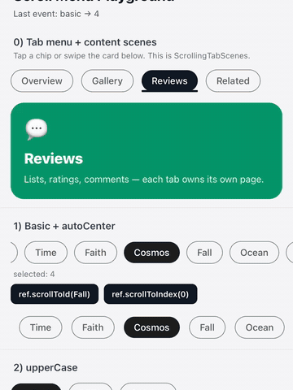
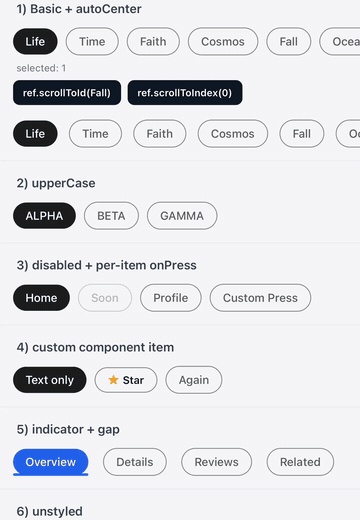

[](https://www.npmjs.com/package/@sekizlipenguen/react-native-scroll-menu)
[](https://www.npmjs.com/package/@sekizlipenguen/react-native-scroll-menu)

# @sekizlipenguen/react-native-scroll-menu

Modern horizontal scrolling menu for React Native.

Plain React source + TypeScript definitions. Auto-centers the active chip, supports custom items, indicators, and optional tab scenes with swipe + fade/scale effects.

---

## Demo

| Tab scenes (swipe + content) | Chips / autoCenter / indicator |
|:----------------------------:|:------------------------------:|
|  |  |

Recorded from the iOS Simulator playground (`example/`).

---

## Installation

```bash
npm install @sekizlipenguen/react-native-scroll-menu
# or
yarn add @sekizlipenguen/react-native-scroll-menu
```

Peer deps: `react`, `react-native` (>= 0.64).

### Local playground

```bash
cd example
npm install
bundle install && bundle exec pod install --project-directory=ios
npm start -- --port 8083
npx react-native run-ios --port 8083
```

`example/` is in git for development — **not published to npm**.

---

## Quick start

```jsx
import React, {useState} from 'react';
import {Text, View} from 'react-native';
import ScrollingButtonMenu from '@sekizlipenguen/react-native-scroll-menu';

export default function Example() {
  const [selected, setSelected] = useState('1');

  return (
    <View>
      <ScrollingButtonMenu
        items={[
          {id: '1', name: 'Life'},
          {id: '2', name: 'Time'},
          {id: '3', name: 'Faith'},
          {id: '4', name: 'Cosmos'},
          {id: '5', name: 'Fall'},
        ]}
        selected={selected}
        onPress={(item) => setSelected(item.id)}
      />
      <Text>Selected: {selected}</Text>
    </View>
  );
}
```

---

## Tab menu + content scenes

Instagram / App Store style: chips on top, a page underneath.

```jsx
import {ScrollingTabScenes} from '@sekizlipenguen/react-native-scroll-menu';

<ScrollingTabScenes
  items={[
    {id: 'overview', name: 'Overview'},
    {id: 'gallery', name: 'Gallery'},
    {id: 'reviews', name: 'Reviews'},
  ]}
  selected={selected}
  onChange={(item) => setSelected(item.id)}
  animation="slide" // 'slide' | 'fade' | 'scale'
  swipeEnabled
  indicator
  renderScene={({item}) => <YourPage id={item.id} />}
/>
```

- Height is **automatic** (measures active scene). Pass `height` only for a fixed viewport.
- `slide` = pager + parallax fade/scale  
- `fade` / `scale` = cross-fade transitions  
- Menu props (`gap`, `indicator`, styles, …) are forwarded to `ScrollingButtonMenu`.

Heavier alternatives if you need Material TabView / collapsing headers:  
[react-native-tab-view](https://reactnavigation.org/docs/tab-view/) · [reanimated-tab-view](https://github.com/adithyavis/reanimated-tab-view) · [collapsible-fluid-tabs](https://github.com/rileysay/react-native-collapsible-fluid-tabs)

---

## More examples

### Custom component item

```jsx
items={[
  {id: '1', name: 'Life'},
  {
    id: '2',
    component: (
      <View style={{alignItems: 'center'}}>
        <Image source={require('./icon.png')} style={{width: 24, height: 24}} />
        <Text style={{fontSize: 12, marginTop: 4}}>Icon</Text>
      </View>
    ),
  },
]}
```

If `component` is set, `name` is not rendered.

### Per-item `onPress`

```jsx
items={[
  {id: '1', name: 'Home'},
  {
    id: '2',
    name: 'Profile',
    onPress: () => console.log('Profile pressed!'),
  },
]}
```

Item-level `onPress` overrides the menu-level handler.

### Disabled, gap, indicator, unstyled

```jsx
<ScrollingButtonMenu
  items={[
    {id: '1', name: 'Home'},
    {id: '2', name: 'Soon', disabled: true},
    {id: '3', name: 'Settings'},
  ]}
  selected={selected}
  onPress={(item) => setSelected(item.id)}
  gap={12}
  indicator
  indicatorStyle={{backgroundColor: '#007AFF', height: 3}}
  // unstyled
/>
```

### Imperative scroll (ref)

```jsx
const menuRef = useRef(null);

<ScrollingButtonMenu
  ref={menuRef}
  items={items}
  selected={selected}
  onPress={(item) => setSelected(item.id)}
/>

menuRef.current?.scrollToId('3');
menuRef.current?.scrollToIndex(0);
```

### Custom `renderItem`

```jsx
<ScrollingButtonMenu
  items={items}
  selected={selected}
  onPress={(item) => setSelected(item.id)}
  renderItem={({item, selected}) => (
    <Text style={{fontWeight: selected ? '700' : '400'}}>{item.name}</Text>
  )}
/>
```

---

## API

### `ScrollingButtonMenu` props

| Key | Type | Default | Description |
|-----|------|---------|-------------|
| `items` | `MenuItem[]` | — | Menu items (**required**) |
| `onPress` | `(item) => void` | — | Item press handler |
| `selected` | `string \| number` | — | Selected id (controlled) |
| `upperCase` | `boolean` | `false` | Uppercase labels |
| `selectedOpacity` | `number` | `0.7` | Press opacity |
| `gap` | `number` | `10` | Space between items |
| `autoCenter` | `boolean` | `true` | Center selected item |
| `unstyled` | `boolean` | `false` | Skip built-in chip styles |
| `indicator` | `boolean` | `false` | Sliding underline |
| `indicatorStyle` | `ViewStyle` | — | Indicator style |
| `renderItem` | `(info) => ReactNode` | — | Custom item renderer |
| `containerStyle` | `ViewStyle` | — | Outer container |
| `contentContainerStyle` | `ViewStyle` | — | Scroll content |
| `scrollStyle` | `ViewStyle` | — | ScrollView style |
| `textStyle` / `activeTextStyle` | `TextStyle` | — | Label styles |
| `buttonStyle` / `activeButtonStyle` | `ViewStyle` | — | Item styles |
| `firstButtonStyle` / `lastButtonStyle` | `ViewStyle` | — | Edge item styles |
| `activeColor` | `string` | — | Active text color |
| `activeBackgroundColor` | `string` | `#1e1e1e` | Active background |
| `scrollEnabled` | `boolean` | `true` | Horizontal scroll |
| `showsHorizontalScrollIndicator` | `boolean` | `false` | Scroll indicator |
| `keyboardShouldPersistTaps` | `string \| boolean` | `'always'` | Keyboard taps |
| `bounces` | `boolean` | `true` | iOS bounce |
| `testID` / `accessibilityLabel` | `string` | — | Testing / a11y |

### `MenuItem`

| Key | Type | Description |
|-----|------|-------------|
| `id` | `string \| number` | Unique id (**required**) |
| `name` | `string` | Label |
| `component` | `ReactNode` | Custom content |
| `onPress` | `(item) => void` | Per-item handler |
| `disabled` | `boolean` | Disable item |
| `accessibilityLabel` / `testID` | `string` | A11y / tests |

### Ref (`ScrollingButtonMenu`)

| Method | Description |
|--------|-------------|
| `scrollToId(id, animated?)` | Center by id |
| `scrollToIndex(index, animated?)` | Center by index |

### `ScrollingTabScenes` extras

| Key | Type | Default | Description |
|-----|------|---------|-------------|
| `onChange` | `(item, index) => void` | — | Selection changed |
| `renderScene` | `(info) => ReactNode` | — | Scene renderer |
| `scenes` | `Record<id, ReactNode>` | — | Alternate scene map |
| `height` | `number` | *auto* | Fixed height (optional) |
| `swipeEnabled` | `boolean` | `true` | Swipe between scenes |
| `animation` | `'slide' \| 'fade' \| 'scale'` | `'slide'` | Transition style |
| `sceneContainerStyle` | `ViewStyle` | — | Scene wrapper style |

Ref: `goToId(id)`, `goToIndex(index)`.

---

## Thank You!

Issues & feedback: [GitHub Issues](https://github.com/sekizlipenguen/react-native-scroll-menu/issues).
